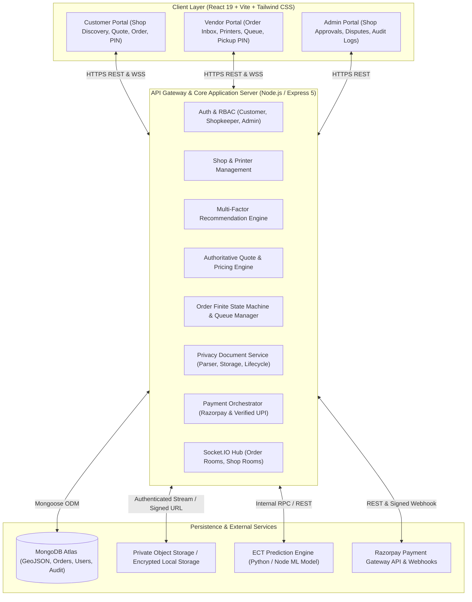

# System Architecture: Printania Platform
**Document Version:** 1.0.0  
**Target Environment:** Production Ready Hyperlocal Printing Cloud  

---

## 1. Architectural Overview

Printania is structured as a resilient, modular cloud-printing platform connecting three key personas: **Customers**, **Shop Operators**, and **Platform Administrators**. The architecture balances rapid synchronous REST operations with asynchronous background processing, real-time WebSocket state distribution, and machine-learning driven queue and recommendation estimation.

### 1.1 High-Level Architecture Diagram

---

## 2. Component Responsibilities

### 2.1 Frontend Client (`client/`)
- **Single Page Application (SPA):** Built with React 19, Vite, and Tailwind CSS.
- **State Management & Routing:** Modular tab and view management for low-latency transitions between Discovery, Customization, Live Order Tracking, and Vendor Dashboard.
- **Geospatial Discovery:** Interactive Leaflet / React-Leaflet maps visualizing active shops, service radii, and recommendation rankings.
- **Client-Side Document Handling:** File format pre-validation (PDF, DOCX) and drag-and-drop feedback.
- **Real-Time Client:** Socket.IO client subscribed to order-specific and shop-specific channels with reconnection resilience.

### 2.2 Core Server (`server/`)
- **Express 5 Application:** RESTful API endpoints handling JSON payloads and `multipart/form-data`.
- **Security & RBAC Middleware:** JWT session validation and role verification (`protect`, `allowRoles('customer', 'shopkeeper', 'admin')`).
- **Authoritative Quote Service:** Decoupled price calculation validating page counts, color modes, duplex savings, paper formats, and finishing fees before order placement.
- **Document Processing & Validation:** Server-side PDF binary parsing to extract authoritative page counts; validates MIME signatures and enforces storage isolation.
- **Order State Machine:** Enforces transition guards (`Pending -> Printing -> Ready -> PickedUp`, `Cancelled`, `Rejected`, `Refunded`).
- **Real-time Event Broker:** Socket.IO server emitting targeted events (`NEW_ORDER_RECEIVED`, `ORDER_STATUS_UPDATED`, `PAYMENT_STATUS_UPDATED`, `receive_chat_message`).
- **Background Cron Workers:**
  - Automated Privacy Cleanup: Enforces document retention deadlines and object deletion.
  - Expired Quote / Stale Order Recovery: Handles abandoned checkout attempts.

### 2.3 Machine Learning Service (ECT Prediction Engine)
- **Target:** Predicts the actual minutes required for an order to progress from its current queue position to `Ready` status.
- **Inputs:** Total pages, number of copies, color mode (B&W vs Color), duplex factor, shop printer inventory, printer speeds (pages-per-minute), active queue workload ahead, and time of day.
- **Architecture:** Dual-strategy implementation:
  1. Primary: Machine learning regression model trained on printing telemetry with feature scaling.
  2. Fallback: Analytical physical baseline model based on printer hardware throughput and queue queueing theory ($M/M/c$ queue model).

### 2.4 Multi-Factor Recommendation Engine
- **Target:** Rank nearby shops based on overall customer utility rather than proximity alone.
- **Scoring Function:**
  $$\text{Score} = w_D \cdot S_{\text{dist}} + w_P \cdot S_{\text{price}} + w_Q \cdot S_{\text{queue}} + w_T \cdot S_{\text{time}}$$
- **Outputs:** Ranked shop list with explicit factor explanations (e.g., "50% faster completion despite 200m extra walk").

---

## 3. Data & Storage Tier

### 3.1 MongoDB Atlas Collections
- `users`: Credentials (bcrypt), role, profile information.
- `shops`: Location (`Point` 2dsphere), contact details, pricing tiers, printer configurations, operating schedules, open/closed flags.
- `orders`: Immutable order snapshot, print options, authoritative price breakdown, payment status, pickup PIN (hashed/hidden), lifecycle timestamps.
- `messages`: Order-linked persistent chat communication between customer and shopkeeper.
- `retention_logs`: Audit trail of document creation, retention schedules, and verified object deletions.

### 3.2 Private Object Storage
- **Primary:** Cloudinary authenticated raw asset storage (signed short-lived URLs).
- **Secondary / Local Development:** Sandboxed local storage directory (`server/uploads`) accessed exclusively through authenticated server streaming (`/api/orders/:id/document`).
- **Public URLs are strictly prohibited.**

