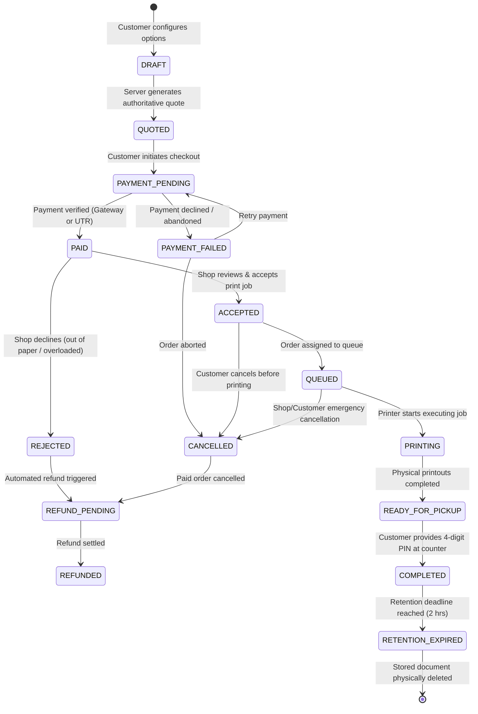

# Order Lifecycle & State Machine Specification

---

## 1. State Machine Definition

The order lifecycle models physical print operations, counter logistics, and digital document retention. Every state change is validated against strict transition guards.

### 1.1 State Diagram

---

## 2. States & Transition Matrix

| Current State | Target State | Actor | Guard Conditions / Rules |
| :--- | :--- | :--- | :--- |
| **`DRAFT`** | `QUOTED` | System | Valid page count, copies, color, duplex, paper format, and shop selection. |
| **`QUOTED`** | `PAYMENT_PENDING` | Customer | Valid document uploaded; quote token unexpired (<15 min). |
| **`PAYMENT_PENDING`** | `PAID` | System / Gateway | Cryptographic Razorpay signature verified OR shopkeeper confirms valid UTR. |
| **`PAYMENT_PENDING`** | `PAYMENT_FAILED` | System | Gateway signals failure or checkout session expires. |
| **`PAID`** | `ACCEPTED` | Shopkeeper | Shop is open; capacity threshold not exceeded. |
| **`PAID`** | `REJECTED` | Shopkeeper | Shop cannot fulfill order (reason required); triggers refund. |
| **`ACCEPTED`** | `QUEUED` | System / Shopkeeper | Job added to shop priority queue; queue position computed. |
| **`QUEUED`** | `PRINTING` | Shopkeeper | Associated printer is active and begins job. |
| **`PRINTING`** | `READY` | Shopkeeper | Printing completed; pages verified and collated. Pickup PIN generated/active. |
| **`READY`** | `PICKED_UP` | Shopkeeper | Customer presents valid 4-digit one-time PIN at the physical counter. |
| **`PAID`/`ACCEPTED`** | `CANCELLED` | Customer | Order has not yet transitioned to `PRINTING`. Triggers refund workflow. |
| **`PICKED_UP`** | `DELETED` | Retention Worker | Retention timer expires (2 hours post-pickup); file unlinked from storage. |

---

## 3. Pickup PIN Security Protocol

To ensure printouts are handed over to the rightful owner and not misrouted in a busy shop:
1. When an order is placed, a cryptographically random 4-digit numeric PIN is generated (`crypto.randomInt(1000, 10000)`).
2. The PIN is stored in the database with `{ select: false }` so it is not returned in standard vendor queries.
3. The PIN is visible only in the customer's live order dashboard.
4. When the customer arrives at the shop counter, they display the 4-digit PIN.
5. The shopkeeper enters the PIN in their portal (`POST /api/orders/:id/pickup`).
6. The backend validates the PIN:
   - If matching: marks order as `PickedUp`, sets `pickedUpAt = new Date()`, clears the PIN, and starts the document retention countdown.
   - If mismatch: increments failed attempt counter, rejects handover, and prevents unauthorized collection.

